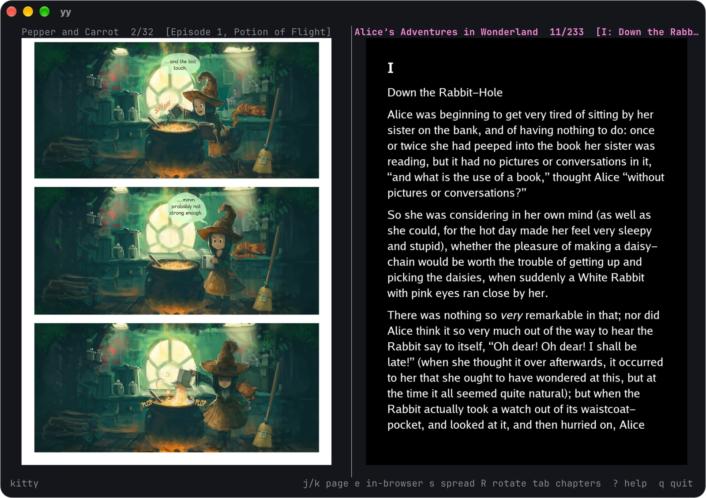
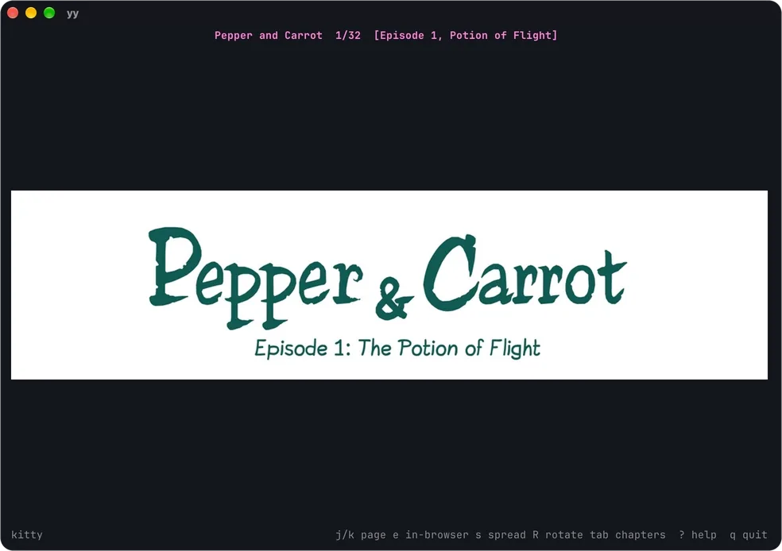
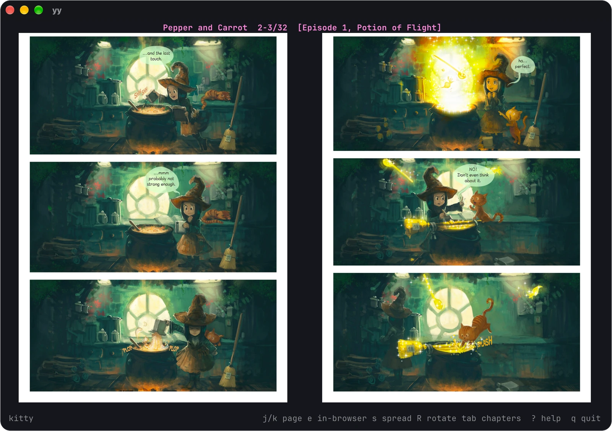
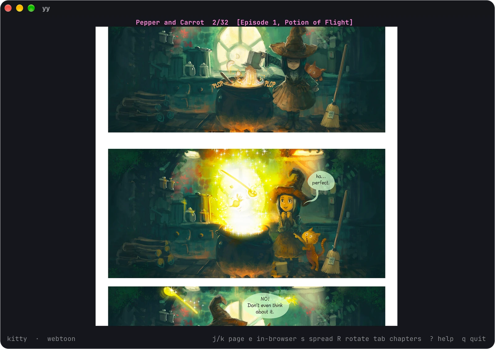
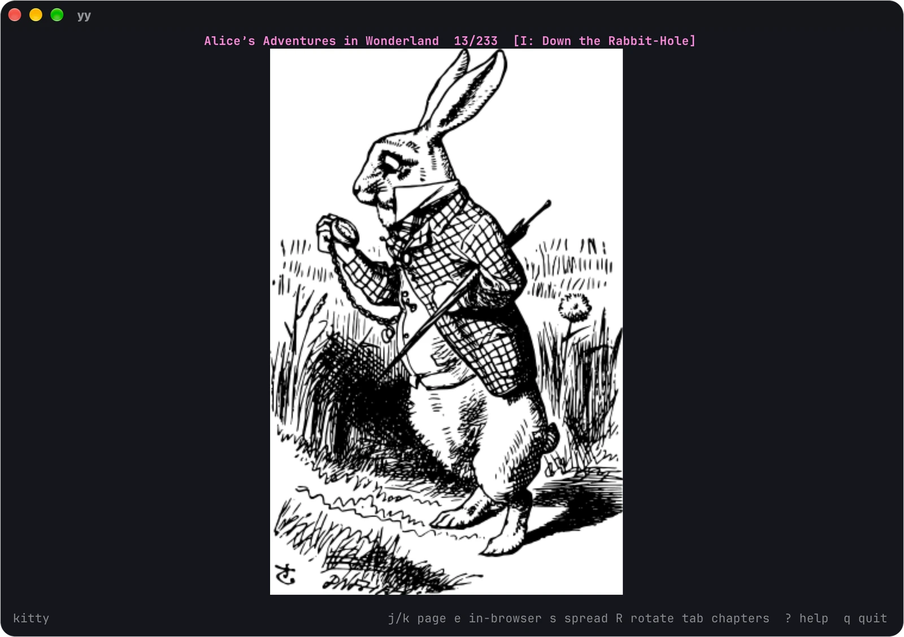
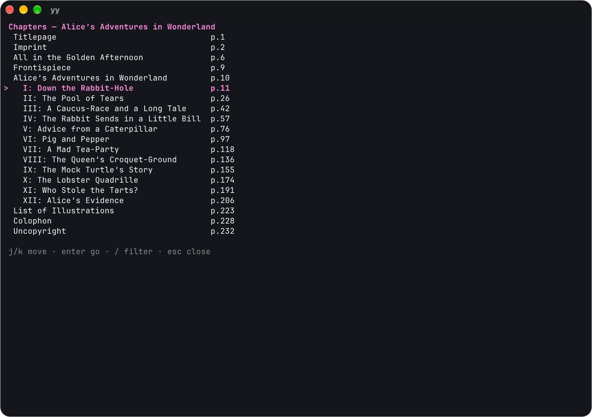

# yoyomi

Yoyomi (夜読み) is Japanese for night reading.

- 夜 (yo) means night
- 読み (yomi) means reading

<p align="center">
  
</p>

<p align="center">
  
</p>

<details>
<summary>More pictures</summary>

| Two-page spread | Webtoon mode |
|---|---|
|  |  |

| A picture in a book | Chapter menu |
|---|---|
|  |  |

</details>

## Contents

- [What yoyomi supports](#what-yoyomi-supports)
- [Install](#install)
  - [From a release](#from-a-release)
  - [With an agent](#with-an-agent)
  - [From source](#from-source)
  - [Optional tools](#optional-tools)
- [Yazi](#yazi)
- [Keys](#keys)
- [Using it](#using-it)
- [Mouse](#mouse)
- [macOS window](#macos-window)
- [Browser reader](#browser-reader)
- [Formats](#formats)
- [How it works](#how-it-works)
  - [Page turns](#page-turns)
  - [Webtoon mode](#webtoon-mode)
  - [Renderers](#renderers)
  - [Cell size](#cell-size)
- [Performance](#performance)
- [License](#license)

## What yoyomi supports

| Format | Read | Chapters | Search | Select text | Links | Needs |
|---|:-:|:-:|:-:|:-:|:-:|---|
| CBZ, CBR | ✅ | ✅ | ✅ | | | |
| EPUB | ✅ | ✅ | ✅ | ✅ | ✅ | |
| FB2 | ✅ | ✅ | ✅ | ✅ | ✅ | |
| DOCX | ✅ | ✅ | ✅ | ✅ | ✅ | |
| DOC | ✅ | ✅ | ✅ | ✅ | ✅ | [antiword](https://github.com/grobian/antiword) |
| PDF | ✅ | ✅ | ✅ | ✅ | ✅ | [Poppler](https://gitlab.freedesktop.org/poppler/poppler) |
| DJVU | ✅ | ✅ | ✅ | | | [DjVuLibre](https://djvu.sourceforge.net/) |

Search in comics and scans runs OCR and needs
[Tesseract](https://github.com/tesseract-ocr/tesseract).

| Terminal | Pictures |
|---|---|
| [kitty](https://github.com/kovidgoyal/kitty), [Ghostty](https://github.com/ghostty-org/ghostty), [cmux](https://github.com/manaflow-ai/cmux) | kitty graphics |
| [iTerm2](https://github.com/gnachman/iTerm2), [WezTerm](https://github.com/wezterm/wezterm), [foot](https://codeberg.org/dnkl/foot), [Konsole](https://github.com/KDE/konsole), [xterm](https://github.com/ThomasDickey/xterm-snapshots) started with `-ti vt340` | sixel |
| [Terminal.app](https://support.apple.com/guide/terminal/welcome/mac) and other truecolor terminals | half blocks |

yoyomi also runs inside [tmux](https://github.com/tmux/tmux) 3.3 or newer
and keeps kitty graphics there.

## Install

### From a release

Each [release](https://github.com/hawkff/yoyomi/releases/latest) has one
archive per system and a `SHA256SUMS` file.

| System | Archive |
|---|---|
| Linux, x86_64 | `yy-x86_64-linux.tar.gz` |
| Linux, ARM64 | `yy-aarch64-linux.tar.gz` |
| macOS, Apple silicon | `yy-aarch64-macos.tar.gz` |
| macOS, Intel | `yy-x86_64-macos.tar.gz` |

Download the archive for your system and the checksums:

```sh
os=$(uname -s | sed 's/Darwin/macos/; s/Linux/linux/')
arch=$(uname -m | sed 's/arm64/aarch64/')
url=https://github.com/hawkff/yoyomi/releases/latest/download
curl -fL -O "$url/yy-$arch-$os.tar.gz" -O "$url/SHA256SUMS"
```

Check the archive. The command prints `OK` beside its name.

```sh
sha256sum --ignore-missing -c SHA256SUMS        # Linux
shasum -a 256 --ignore-missing -c SHA256SUMS    # macOS
```

Unpack it and put `yy` on your `PATH`:

```sh
tar -xzf "yy-$arch-$os.tar.gz"
mkdir -p ~/.local/bin && mv yy ~/.local/bin/
yy --version
```

A browser marks its downloads on macOS, and macOS then refuses to run them.
`curl` sets no mark. To clear one:

```sh
xattr -d com.apple.quarantine yy
```

### With an agent

Paste the prompt below into a coding agent that has a shell on your machine.

<details>
<summary>Prompt</summary>

```text
Install yoyomi, the terminal reader whose command is `yy`, from
https://github.com/hawkff/yoyomi on this machine.

1. Find the latest release. Pick the archive for this system and CPU:
   yy-x86_64-linux.tar.gz, yy-aarch64-linux.tar.gz,
   yy-aarch64-macos.tar.gz or yy-x86_64-macos.tar.gz.
2. Download that archive and SHA256SUMS from the release. Compute the
   archive's SHA-256, show it to me beside its line in SHA256SUMS, and stop
   if the two differ.
3. Unpack the archive and tell me what it holds. Install `yy` in
   ~/.local/bin, creating the directory if needed. Use sudo only if I say
   so. Tell me if ~/.local/bin is missing from my PATH.
4. Run `yy --version` and show me the output.
5. Check for the optional tools: pdfinfo, pdftoppm, pdftohtml and pdftotext
   (Poppler), djvused and ddjvu (DjVuLibre), antiword, and tesseract. List
   the missing ones with the one command that installs them on this system,
   taken from the README. Ask before you run it.
6. Ask me whether yy should open comics and books in Yazi. If I say yes,
   add the opener and the rules from the README's Yazi section to
   ~/.config/yazi/yazi.toml, keep the rest of the file as it is, and show
   me the diff before you write it.
```

</details>

### From source

yoyomi needs [Rust](https://github.com/rust-lang/rust) 1.99 or newer.

```sh
cargo install --locked --git https://github.com/hawkff/yoyomi yoyomi
```

That builds `yy` and puts it in `~/.cargo/bin`. In a clone,
`cargo build --release` leaves it at `target/release/yy`.

### Optional tools

Comics, EPUB, FB2 and DOCX need nothing else. The rest is optional:

- PDF needs [Poppler](https://gitlab.freedesktop.org/poppler/poppler):
  `pdfinfo` and `pdftoppm` to show pages, `pdftohtml` and `pdftotext` for
  outlines, links, search and selection.
- DJVU needs [DjVuLibre](https://djvu.sourceforge.net/): `djvused` and
  `ddjvu`.
- DOC needs [antiword](https://github.com/grobian/antiword).
- OCR search needs [Tesseract](https://github.com/tesseract-ocr/tesseract).
- Links open through `xdg-open` on Linux
  ([xdg-utils](https://gitlab.freedesktop.org/xdg/xdg-utils)).
- Copying falls back to [wl-clipboard](https://github.com/bugaevc/wl-clipboard)
  or [xclip](https://github.com/astrand/xclip) in terminals without OSC 52.
- Books with symbols or CJK text need fonts that have them, such as
  [DejaVu](https://github.com/dejavu-fonts/dejavu-fonts) and
  [Noto](https://github.com/notofonts/noto-cjk).

One command installs them all. Open your system for it.

<details>
<summary>Debian, Ubuntu</summary>

```sh
sudo apt install \
  poppler-utils \
  djvulibre-bin \
  antiword \
  tesseract-ocr \
  xdg-utils \
  wl-clipboard \
  xclip \
  fonts-dejavu-core \
  fonts-noto-core \
  fonts-noto-cjk
```

</details>

<details>
<summary>Fedora</summary>

```sh
sudo dnf install \
  poppler-utils \
  djvulibre \
  antiword \
  tesseract \
  tesseract-langpack-eng \
  xdg-utils \
  wl-clipboard \
  xclip \
  dejavu-sans-fonts \
  google-noto-sans-symbols-2-fonts \
  google-noto-sans-cjk-fonts
```

</details>

<details>
<summary>Arch</summary>

With pacman:

```sh
sudo pacman -S --needed \
  poppler \
  djvulibre \
  antiword \
  tesseract \
  tesseract-data-eng \
  xdg-utils \
  wl-clipboard \
  xclip \
  ttf-dejavu \
  noto-fonts \
  noto-fonts-cjk
```

With [yay](https://github.com/Jguer/yay):

```sh
yay -S --needed \
  poppler \
  djvulibre \
  antiword \
  tesseract \
  tesseract-data-eng \
  xdg-utils \
  wl-clipboard \
  xclip \
  ttf-dejavu \
  noto-fonts \
  noto-fonts-cjk
```

</details>

<details>
<summary>Alpine</summary>

```sh
doas apk add \
  poppler-utils \
  djvulibre \
  antiword \
  tesseract-ocr \
  tesseract-ocr-data-eng \
  xdg-utils \
  wl-clipboard \
  xclip \
  font-dejavu \
  font-noto-symbols \
  font-noto-cjk
```

</details>

<details>
<summary>macOS</summary>

With [Homebrew](https://github.com/Homebrew/brew):

```sh
brew install \
  poppler \
  djvulibre \
  tesseract
```

Homebrew has no antiword formula.

[MacPorts](https://github.com/macports/macports-base) has one:

```sh
sudo port install antiword
```

Without antiword only DOC files fail to open.

</details>

## Yazi

Add yoyomi as an opener in `~/.config/yazi/yazi.toml` to read from
[Yazi](https://github.com/sxyazi/yazi). Open one file to read it, or select
two for a split. `block = true` hands the terminal to yoyomi until you quit.

```toml
[opener]
yy = [
  { run = 'yy %s', block = true, desc = "Read in yoyomi" },
]

[open]
prepend_rules = [
  { url = "*.{cbz,cbr,epub,fb2,docx,doc,pdf,djvu,djv}", use = "yy" },
  { url = "*.fb2.zip", use = "yy" },
  { mime = "application/epub+zip", use = "yy" },
  { mime = "application/vnd.comicbook+zip", use = "yy" },
  { mime = "application/vnd.comicbook-rar", use = "yy" },
]
```

`url` globs match in any letter case, so `*.CBZ` is covered. To keep the
default openers in the "open with" menu, write `use = ["yy", "open"]`.

## Keys

| Key | Action |
|---|---|
| `j` / `k` | next / previous page or spread; in webtoon mode, one viewport (`2j` for two) |
| `J` / `K` | next / previous page or spread; in webtoon mode, half a viewport |
| `g` / `G` | first / last page (`42G` goes to page 42) |
| `z` | focus mode: hide the titles and the status bar |
| `t` | webtoon mode: one continuous strip with eased scrolling (single pane); wide pages shrink to fit, narrow pages keep their size |
| `s` | two-page spread (single pane) |
| `w` | switch pane |
| `v` | split or unsplit, keeping the active pane |
| `o` / `O` | open a book in this pane / in a split |
| `x` | close the pane |
| `tab` | chapter menu |
| `b` | bookmark the page, or remove its bookmark |
| `F` | bookmarks menu |
| `/` in menus | fuzzy filter (subsequence match) |
| `r` / `d` in bookmarks | rename / delete a bookmark |
| `/` | search the book's text and the text layers of PDF and DJVU files; OCR the other pages with Tesseract (`YOYOMI_OCR_LANG`, default `eng`) |
| `n` / `p` | next / previous hit |
| `e` | open the book in the browser |
| `f` | open the book in the native macOS window; `f` there returns to the terminal |
| `S` | save the page as PNG (`$YOYOMI_SHOT_DIR` or the current directory) |
| `R` | rotate 90° clockwise |
| `i` | invert the active pane: text pages in books, whole pages in comics, PDF and DJVU |
| `+` / `-` / `0` | zoom in / out / reset |
| arrows | pan while zoomed; scroll a text page that overflows the pane |
| mouse wheel | next / previous page; in webtoon mode, scroll |
| `r` | render again |
| `?` | help, in pages when the screen is too short for it |
| `q` / `ctrl+c` | forget the saved positions of the open books and quit |
| `Q` | save the positions of the open books and quit |

Search reads book text and the text layers of PDF and DJVU files. It runs
OCR on the other pages in the background and keeps what it reads while the
book is open. Phrases match across line breaks, and `n` and `p` wrap
around. The final status counts the pages search could not read, such as
scans on a machine without Tesseract. Opening another book, toggling the
split, closing a pane or opening the macOS window cancels the search. A
split has one search, and `n` and `p` go to the pane it ran in and make it
active.

The chapter menu reads PDF and DJVU outlines, EPUB 3 navigation and EPUB 2
NCX tables of contents, FB2 section titles, and DOC and DOCX headings. DOCX
headings include inherited styles and paragraph outline levels. Comic
archives use [ComicInfo.xml](https://github.com/anansi-project/comicinfo)
bookmarks or the folders that hold their pages. Nested entries keep their
order and indentation, and selecting one turns to its page. Outlines load
in the background after a book opens.

## Using it

```sh
yy                   # start empty, then press o to open a book
yy book.cbz          # read a book
yy a.cbz b.epub      # read two books side by side
yy -r sixel book.pdf # force a renderer: kitty, sixel or halfblock
yy -c *.cbz          # check books without opening the reader
```

Positions and bookmarks live in `$XDG_CONFIG_HOME/yoyomi` (by default
`~/.config/yoyomi`) on Linux and in `~/Library/Application Support/yoyomi`
on macOS.

To fill the screen with the page, make the terminal fullscreen with its own
key (`Ctrl+Shift+F11` in kitty, `Alt+Enter` in WezTerm, `Ctrl+Shift+F` in
Konsole) or the window manager's, then press `z` to hide the titles and the
status bar. In the browser reader, `F11` does the same.

## Mouse

On book and PDF pages, drag to select text. yoyomi highlights the selection
and copies it when you release the button. It sends OSC 52, runs
`tmux load-buffer -w` inside tmux, and tries `pbcopy`, `wl-copy` and `xclip`
in turn. That covers tmux's default `set-clipboard`,
[GNOME Terminal](https://github.com/GNOME/gnome-terminal) and macOS
Terminal, which drop OSC 52.

Click a link to follow it. Web and mail links open in the browser, and
references inside the book turn to their page. Hovering over a link shows
where it goes in the status bar, and a right click copies it. Opened and
copied links lose tracking parameters such as `utm_*`, `fbclid`, `gclid`
and `si`. In a split, a click makes the pane under it active.

Book pages carry their text from the layout. A PDF page reads its text with
`pdftotext` and `pdftohtml` the first time the mouse moves over it, so a
scanned PDF without a text layer has nothing to select. Selection needs an
unrotated page outside webtoon mode. DJVU text serves search only, without
word positions, so DJVU pages have nothing to select. Terminals without
pixel graphics show book text as plain text; hold shift there to use the
terminal's own selection.

## macOS window

`f` opens the active pane's book in a fullscreen window and hands over the
page, the webtoon position, rotation, zoom, spread and inversion. `f` in
the window brings them back to the terminal. The window draws at the
screen's full resolution and, like the terminal, turns to pages rendered
ahead. Its keys follow the terminal's: counts, `j`/`k`/`J`/`K`, `g`/`G`
(`42G` goes to page 42), `s`, `t`, `R`, `i`, `+`/`-`/`0` and the arrows to
pan. The mouse wheel and the trackpad turn pages, or scroll in webtoon
mode, and a click follows a link. `Q` saves the positions of the open books
and quits. `q` or closing the window forgets them and quits. On other
systems, `f` reports that the window is unavailable.

## Browser reader

`e` starts a server on `127.0.0.1` at a random port from 50000 through
59999, then opens the current book and page through a one-time link. The
link redirects to a URL with a random token, so the token never appears on
a command line, and the token URL's root lists the open books. On Linux,
where it can read `/proc/net/tcp`, the server also turns away connections
from other users.

The server sends page images with `Cache-Control: no-store`, so the browser
keeps none of them. A reader page left open follows its pane: after the
pane gets another book, reload the page. The browser page lists its keys in
the header and opens with the active pane's inversion.

Over SSH, forward the port with `ssh -L PORT:127.0.0.1:PORT` and open the
link from the status bar. It works once, and `e` makes a new one.

## Formats

- CBZ/ZIP and CBR/RAR archives, solid and split RAR included. yoyomi tells
  formats apart by their signature, so a file with a wrong extension still
  opens. Comic pages follow natural order (`p2` before `p10`).
- yoyomi lays EPUB text out into fixed pages with the bundled
  [Go fonts](https://github.com/golang/image/tree/master/font/gofont) (regular, bold, italic) and
  system fonts for other scripts, following the package spine and document
  order. Set `YOYOMI_EPUB_FALLBACK_FONT` to a TTF, OTF or TTC file to
  replace the system font search. `h1` and `h2` headings start a page.
  Lists, `pre` blocks and ruby readings keep their shape. A bold or italic
  run inside a paragraph keeps its face. MathML shows its alternative text,
  and audio, video and embedded objects show their fallback text. A picture
  with transparent pixels sits on white, like the text pages.
- FB2, plain or zipped, gets the same layout. The cover comes first,
  section titles start pages and fill the chapter menu, and notes follow
  the main text. Emphasis and pictures stay, and yoyomi decodes
  windows-1251 and koi8-r.
- DOCX keeps heading styles, bold and italic runs, list bullets, tables as
  one paragraph per cell, text boxes and pictures. DOC goes through
  antiword's DocBook output, which keeps headings.
- PDF and DJVU pages render when shown, through `pdftoppm` and `ddjvu`,
  scaled to fit 2000 × 2000 pixels. `-c` only counts their pages.
- Page images decode from JPEG, PNG, GIF, WebP and BMP.
- Decompressed page data stops at 64 MiB and page images at 32 million
  pixels. Reaching a page in a solid RAR may decode at most 100 times the
  archive's size on disk, all volumes counted, or 1 GiB for small archives.
  ComicInfo.xml must fit in 1 MiB, and FB2 files and DOCX documents in
  32 MiB.
- On a network share, a ZIP-based book (CBZ, EPUB, DOCX, zipped FB2) opens
  in a few round trips, because yoyomi reads archives through a 1 MiB
  buffer. It reads RAR volumes header by header, and they open slower
  there.

## How it works

### Page turns

While you read a page, yoyomi scales and encodes the next one and, in
kitty, uploads it under its own image id. Turning to it draws placeholder
cells and sends no image data. Inside tmux the image travels with the turn,
because tmux can drop what arrives early.

### Webtoon mode

Each page scales once to the viewport width. In kitty the strip goes to the
terminal as bands it keeps, so scrolling back over them sends no image
data, and only the bands coming into reach upload. Sixel and half blocks
send a new image of the viewport for each frame of a scroll.

### Renderers

At startup yoyomi asks the terminal for its cell size and device
attributes, then picks the first renderer the terminal supports.

- `kitty` is the kitty graphics protocol with Unicode placeholders
  (`U=1`). It runs in kitty, Ghostty and cmux. Under tmux 3.3 or newer,
  yoyomi asks tmux which terminal its client runs in, by its `TERM` and by
  the name tmux got from the terminal's XTVERSION reply. When tmux knows no
  name, the kitty and Ghostty variables the session inherited decide, which
  covers a Ghostty-based terminal that sets `TERM=xterm-256color`. yoyomi
  sets the pane's `allow-passthrough` to `all`, or to `on` where tmux lacks
  `all`. kitty's placeholders carry the image id in a 24-bit color, so the
  tmux client needs the `RGB` feature.
  [zellij](https://github.com/zellij-org/zellij),
  [GNU screen](https://www.gnu.org/software/screen/) and terminals started
  from kitty inherit kitty's variables, and yoyomi ignores them there. Pass
  `-r kitty` when detection misses, for example over SSH.
- `sixel` draws pages as sixel images. yoyomi picks it when the terminal's
  device attributes list sixel graphics. Gray pages keep their exact gray
  levels. Color pages get a median-cut palette sized to the terminal's
  color registers, up to 256. Text written over a sixel image erases the
  pixels under it, so yoyomi clears the cells under an image once, draws
  the image and leaves those cells alone until the page changes. In focus
  mode the bottom row stays empty, because the terminal moves the cursor
  below an image and an image on the last row would scroll the screen. Pass
  `-r sixel` when detection misses.
- `halfblock` draws U+2580 with truecolor foreground and background, two
  pixels per cell, in any 24-bit color terminal. Each half cell shows the
  average of the pixels it covers. Text pages of books show as plain text
  in this renderer, and the arrow keys scroll a page that overflows the
  pane.

Inside a [herdr](https://github.com/herdrdev/herdr) pane, yoyomi sends a
kitty graphics query and uses the kitty renderer when herdr accepts it.
herdr accepts the query even when the terminal around it lacks kitty
graphics, and pages then stay blank. Pass `-r halfblock` there, or set
`terminal.kitty_graphics = false` in herdr's config, which makes herdr
refuse the query.

### Cell size

A picture fills its cells only when yoyomi knows a cell's size in pixels.
It takes the size from the terminal's XTWINOPS reply and the tty's window
size, whichever is smaller. Before every frame it reads the terminal's size
again, so it follows a resize or a font change even when the signal for it
was missed, as when a terminal grows its window while yoyomi starts.

Three terminals need more:

- xterm answers no cell-size query and counts its border in the window
  size, so yoyomi rounds cells down to whole pixels and sixel images stay
  inside their cells.
- iTerm2 and WezTerm draw a sixel pixel as a device pixel and report the
  window in device pixels on the tty, but iTerm2 answers the cell-size
  query in points, and WezTerm answers with a size it corrects within its
  first 15 ms. Outside tmux, GNU screen and zellij, yoyomi takes the tty's
  size alone in these two, so sixel pages fill their cells on a Retina
  display.
- iTerm2 paints the pixels a sixel image leaves out, in a color of the
  image. yoyomi asks iTerm2 for its background color at startup (OSC 11)
  and names that color in the image, so the margins beside a webtoon page
  stay the color of the window.

## Performance

These times run from the key press to the last byte of the new picture,
through a pty with 160 × 50 cells of 10 × 20 pixels, on 1600 × 2400 JPEG
scans and a webtoon of 800 × 6000 pages.

| Renderer | Action | Time | Data sent |
|---|---|---|---|
| kitty | page turn | 1 ms | placeholder cells; the page was in the terminal already |
| kitty | webtoon `j` | 0.15 s | 2.4 MiB |
| sixel | page turn | 2 ms | one sixel image |
| sixel | webtoon `j` | 0.5 s | 16 MiB |
| halfblock | page turn | 1 ms | one screen of cells |
| halfblock | webtoon `j` | 0.16 s | 2.7 MiB |

A webtoon `j` eases over about 0.15 s. In kitty, yoyomi uploads the page
after the one you turn to once the turn is on screen. Inside tmux, measured
the same way, a webtoon `j` takes about 0.3 s, and a page turn carries its
image.

## License

MIT
